# BelAir OS

**BelAir OS** est un launcher sur mesure pour une TV **Samsung S95H (Tizen 9)** rootée : il remplace l'accueil Samsung par une interface rapide, en français, qui réunit la TV, l'Apple TV, Plex, la maison connectée (Home Assistant), les transports, la météo, la bourse et l'électricité.

Il est construit sur [Quiet Tizen](docs/quiet-tizen.md) (launcher natif NUI/C#, outils de nettoyage et de restauration) et en garde les principes : tout est réversible, rien ne tourne en root en permanence, et la TV reste une TV (HDMI, son, réseau, Bluetooth intacts).

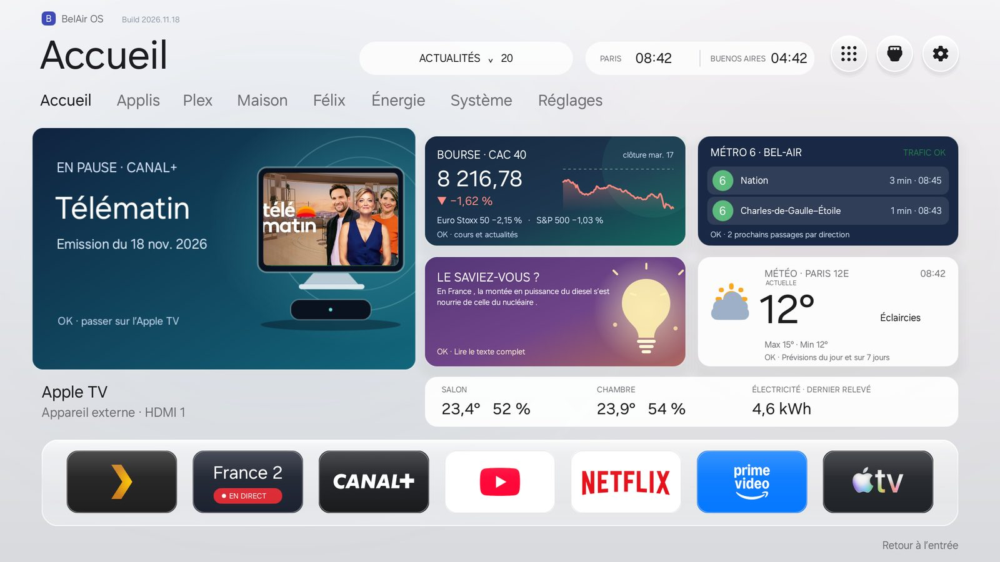

---

## Sommaire

- [Pages](#pages)
- [Maison connectée](#maison-connectée)
- [Divertissement](#divertissement)
- [Infos du quotidien](#infos-du-quotidien)
- [Réglages et apparence](#réglages-et-apparence)
- [Architecture](#architecture)
- [Installer et déployer](#installer-et-déployer)
- [Données personnelles](#données-personnelles)
- [Crédits](#crédits)

## Pages

| Onglet | Contenu |
|---|---|
| **Accueil** | Tuile Apple TV avec ce qui est en lecture (affiche, progression, temps restant), Bourse CAC 40, « Le saviez-vous ? », métro 6 en temps réel, météo, températures intérieures, électricité, heure de Paris et de Buenos Aires, dock d'applis qui s'ouvrent directement sur l'Apple TV (dont **France 2 en direct**) |
| **Applis** | Toutes les applis installées, avec leurs vraies icônes, triées par usage |
| **Plex** | Ce qui joue sur l'Apple TV, « Reprendre » (Continuer à regarder, À suivre) et « Ajoutés récemment », lancement direct dans Plex |
| **Maison** | Scènes, volets, lampes, lampes Govee avec scènes, mode cinéma automatique |
| **Félix** | Robot aspirateur : carte en direct, état, entretien, nettoyage par pièce et programmes |
| **Vélos** | Les 4 stations Vélib' les plus proches (vélos mécaniques, électriques, places) et les Lime disponibles sur un plan des rues (Plan IGN) centré sur le domicile ; les flèches parcourent le plan (autonomie de chaque Lime) |
| **Localiser** | Protégée par un code PIN : les appareils et objets de Localiser (intégration iCloud de Home Assistant) avec lieu, distance, batterie et dernière localisation, sur un plan des rues ; OK centre la carte sur un appareil, un appui long le fait sonner après confirmation |
| **Énergie** | Consommation électrique quotidienne sur 30 jours (Linky / Octopus) |
| **Système** | Infos TV : système, réseau, processeur, mémoire, stockage |
| **Réglages** | Volume, luminosité et contraste, mode d'image, mode jeu, son, minuterie, réseau, thème, couleur, fond d'écran, brief du matin |

Pages ouvertes depuis l'accueil : **Météo** (prévisions horaires et 7 jours), **Information trafic** (métro et RER), **Actualités** (franceinfo, articles complets avec photos) et **Bourse** (13 valeurs, graphiques).

## Maison connectée

Tout passe par **Home Assistant** (local en priorité, accès distant en secours).

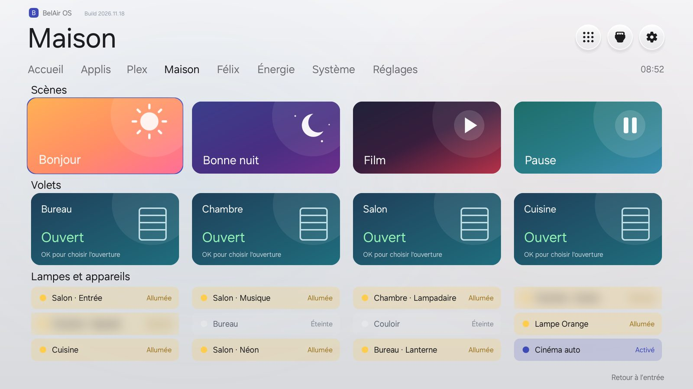

- **Scènes** Bonjour, Bonne nuit, Film, Pause en un clic.
- **Volets** réglables finement (fermé, 25, 50, 75 %, ouvert), avec la position réelle affichée.

  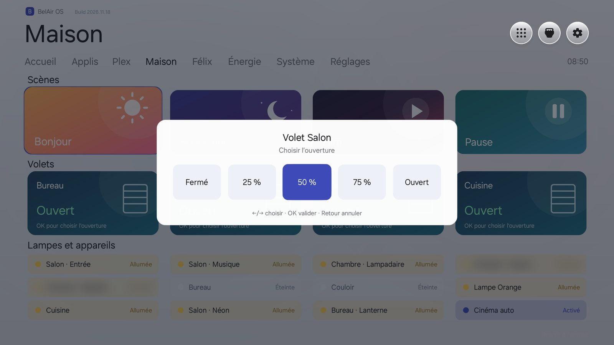

- **Lampes** allumées/éteintes en un clic, groupe cuisine compris.
- **Lampes Govee** (néon du salon, lanterne du bureau, lampadaire et rétroéclairage TV) : un panneau façon app Govee avec luminosité, **mode musique** (styles Govee), options (DreamView, zones de lumière), **scènes Govee** (les plus populaires en premier, puis tout le catalogue par catégorie : 362 pour le néon, 107 pour la lanterne, noms en français), ambiances prêtes à l'emploi, couleurs et blancs. Allumage, luminosité et couleurs passent par le réseau local (instantané), seules les scènes passent par le cloud Govee.

  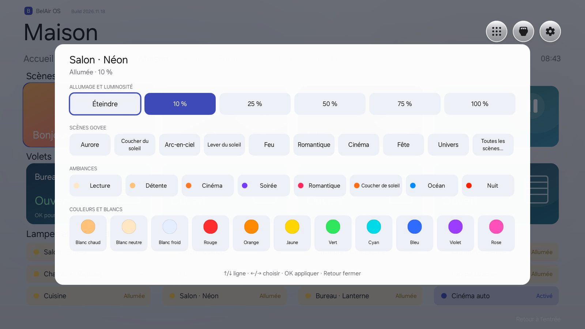
  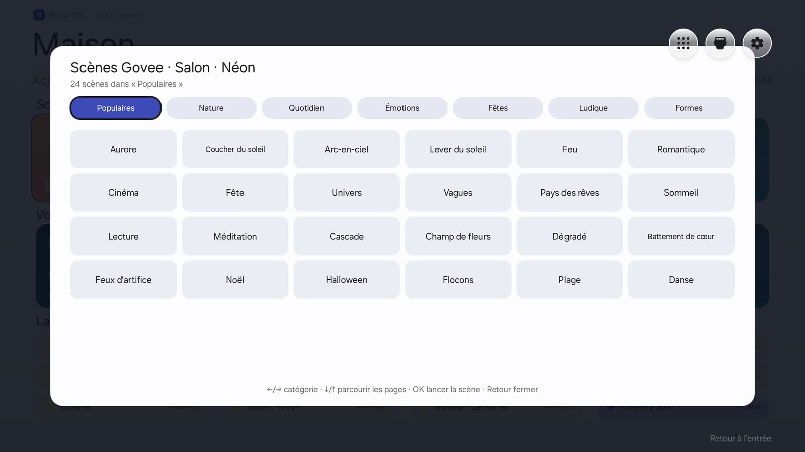

- **Mode cinéma automatique** : quand Plex ou Netflix joue sur l'Apple TV (ou Plex sur la TV), les lumières s'éteignent, le néon passe à 5 % et les volets se ferment ; à la pause, les lampes se rallument sans toucher aux volets, et à l'arrêt le néon retrouve son état d'avant le film.
- **Lampes IKEA** : OK allume ou éteint, un appui long ouvre le réglage de luminosité.
- **Félix**, le robot aspirateur : carte de l'appartement rafraîchie toutes les 8 s pendant le ménage, batterie, pièce en cours, entretien des brosses et filtres, **nettoyage sur mesure** (choix des pièces, aspirer / laver / les deux) et programmes enregistrés.

  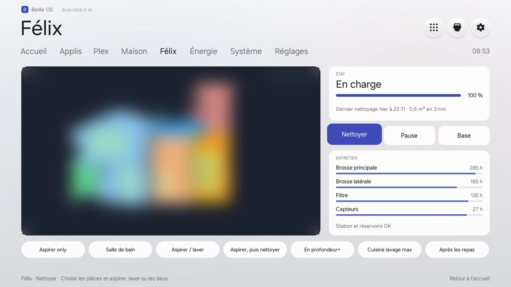

## Notifications sur la TV

Des popups s'affichent en haut à droite de l'écran **par-dessus n'importe quelle source**, Apple TV comprise, sans quitter le film : seules les touches OK et Retour sont réservées pendant qu'une popup est visible. OK la ferme, tout comme un clic central sur la télécommande de l'Apple TV (la lecture reste comme elle était).

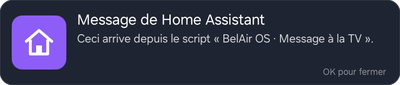

- **Depuis Home Assistant** : le script « BelAir OS · Message à la TV » (titre, message, icône ou image d'une entité, durée) émet l'événement `belair_notify` ; la TV, abonnée en direct, l'affiche en une seconde. Un tableau de bord « BelAir OS » permet d'écrire un message ou d'envoyer des messages rapides.
- **Automatiques** : Félix a fini son ménage (avec sa carte) ou a besoin d'aide, pluie attendue dans l'heure.

## Vélos et Localiser

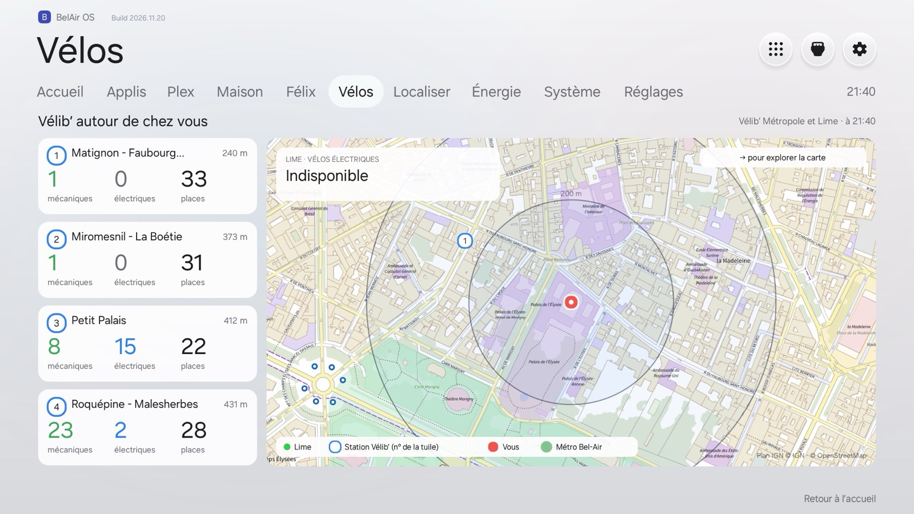

- **Vélos** : les 4 stations Vélib' les plus proches, numérotées comme sur le plan, et les vélos Lime disponibles à moins de 400 m ; → entre dans le plan pour voir l'autonomie de chaque Lime.

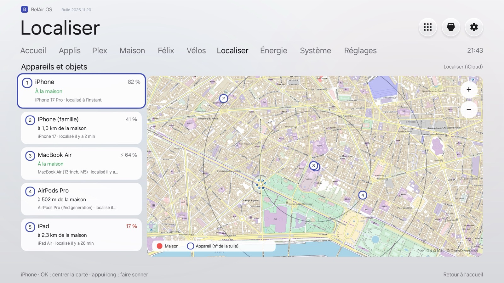

- **Localiser** : les appareils de Localiser (intégration iCloud de Home Assistant) avec batterie et dernière localisation. OK centre la carte sur un appareil, CH +/− ou les boutons + et − règlent le zoom, de la rue au monde entier, et le bouton Déplacer permet de parcourir la carte avec les flèches, un appui long propose de le faire sonner (Annuler sélectionné par défaut).

| | |
|---|---|
| 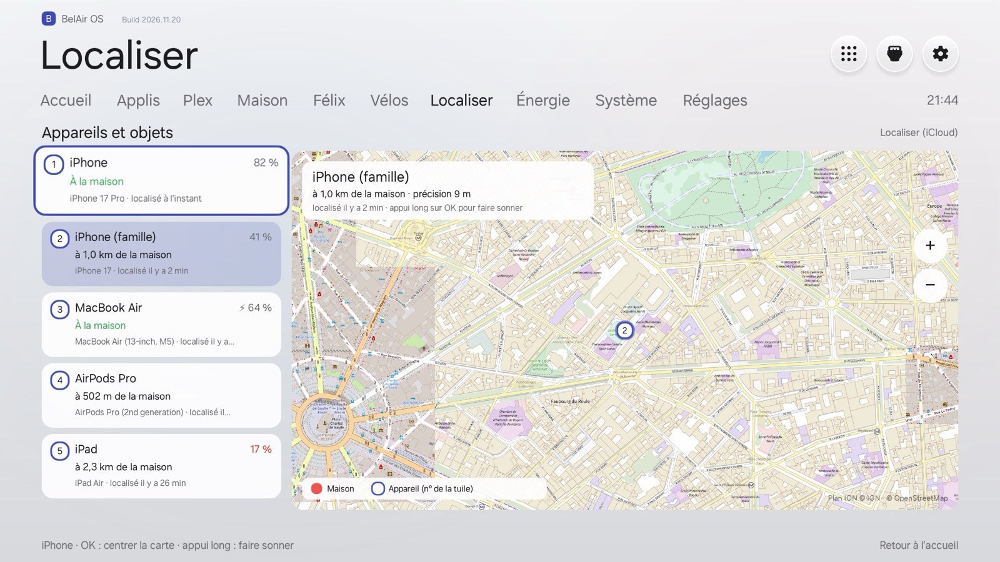 | 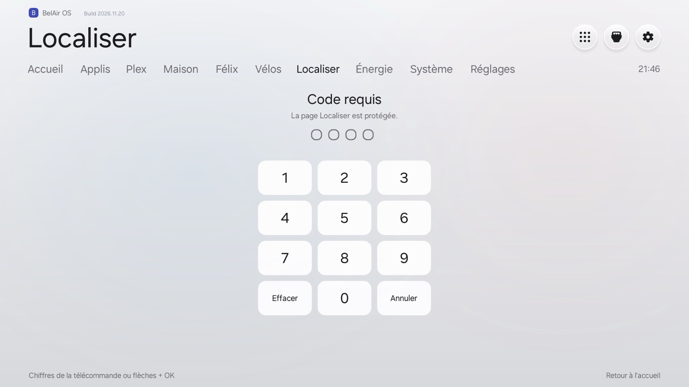 |

La page est protégée par un code à 4 chiffres choisi sur la TV (stocké haché sur la TV seulement) ; le clavier part toujours du 1 et n'affiche aucune sélection, pour que personne ne puisse lire le code.

## Divertissement

- **Apple TV** : la tuile d'accueil montre en direct ce qui est en lecture (titre, appli, illustration dans l'écran dessiné, progression).
- **Plex** : « Reprendre » (Continuer à regarder, À suivre) et « Ajoutés récemment » avec affiches, lus via le lecteur Plex de l'Apple TV ou de la TV ; OK ouvre Plex et lance le titre choisi.

  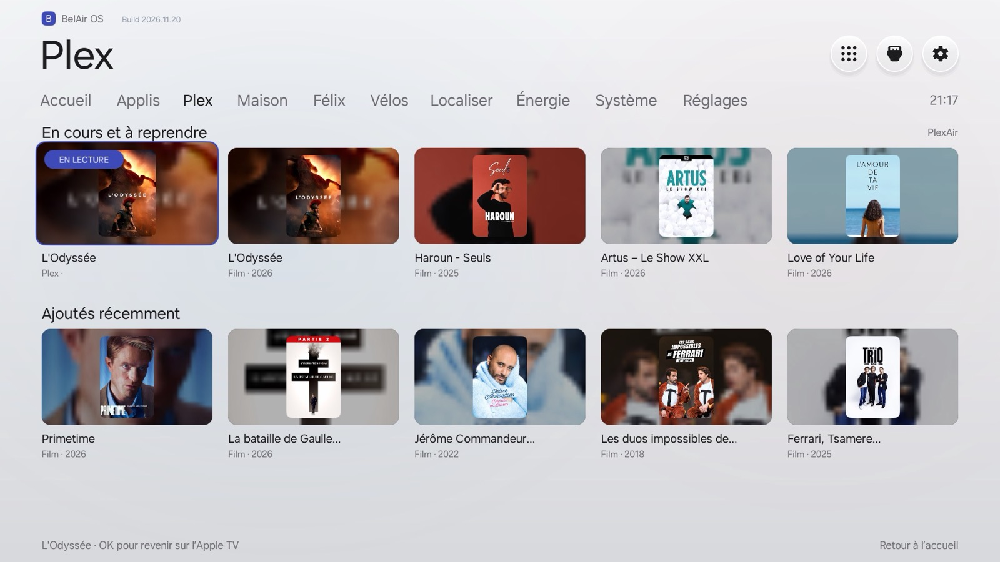

- **France 2 en direct** : une tuile du dock passe la TV sur l'Apple TV et lance le direct dans CANAL+ (≈ 4 s).

## Infos du quotidien

| | |
|---|---|
| 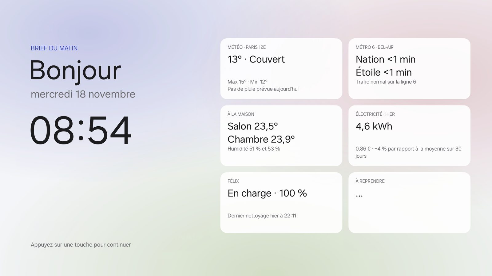 **Brief du matin** — au premier allumage entre 5 h et 11 h : météo, métro, maison, électricité, Félix, Plex. | 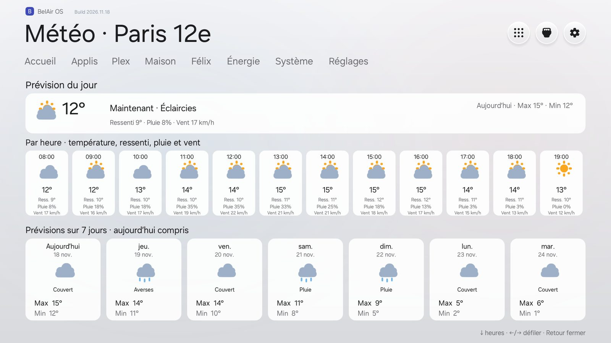 **Météo** — heure par heure (température, ressenti, pluie, vent) et 7 jours, avec source de secours. |
| 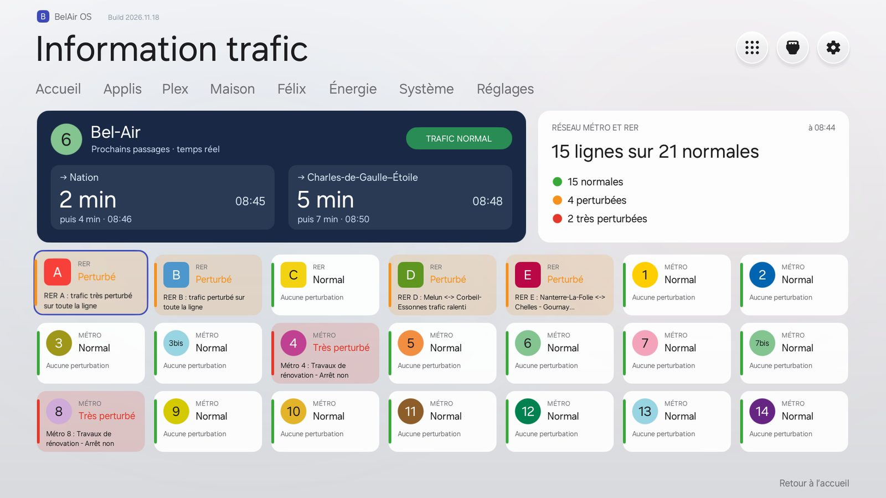 **Information trafic** — passages en temps réel à Bel-Air dans les deux sens, état des 16 lignes de métro et 5 RER. | 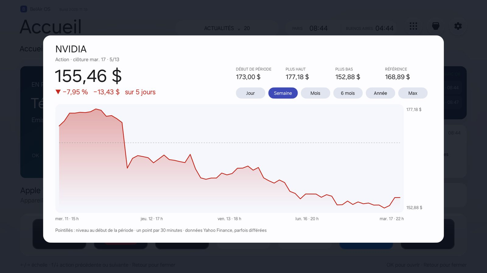 **Bourse** — CAC 40, Euro Stoxx 50, S&P 500, QQQ, NVIDIA, AMD, Micron, SanDisk, Alphabet, Apple, or, cuivre, EUR/USD ; graphique Jour à Max. |
| 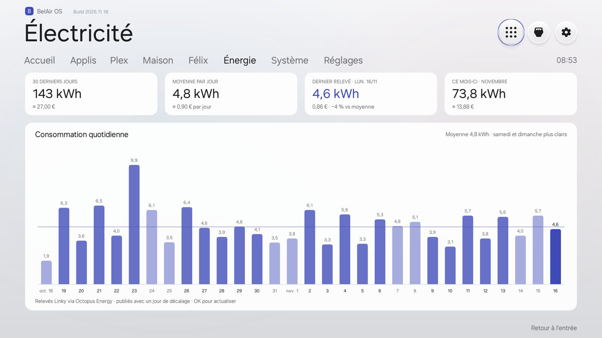 **Énergie** — 30 derniers jours, coût, moyenne, mois en cours. | 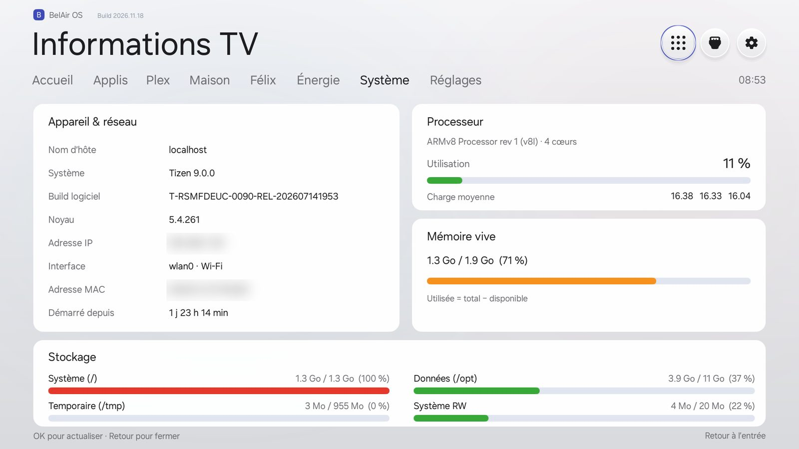 **Système** — santé de la TV en direct. |

La tuile météo annonce la **pluie dans l'heure** (prévision par quart d'heure). « Le saviez-vous ? » puise dans les anecdotes de la page d'accueil de Wikipédia (actuelles et archives), renouvelées chaque jour.

## Réglages et apparence

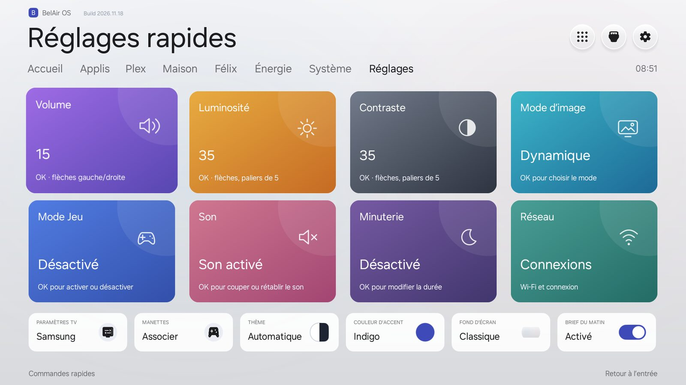

- Volume, **luminosité et contraste par paliers de 5**, **mode d'image** (Dynamique, Standard, Éco, Cinéma…) choisi directement, mode jeu, son, minuterie.

  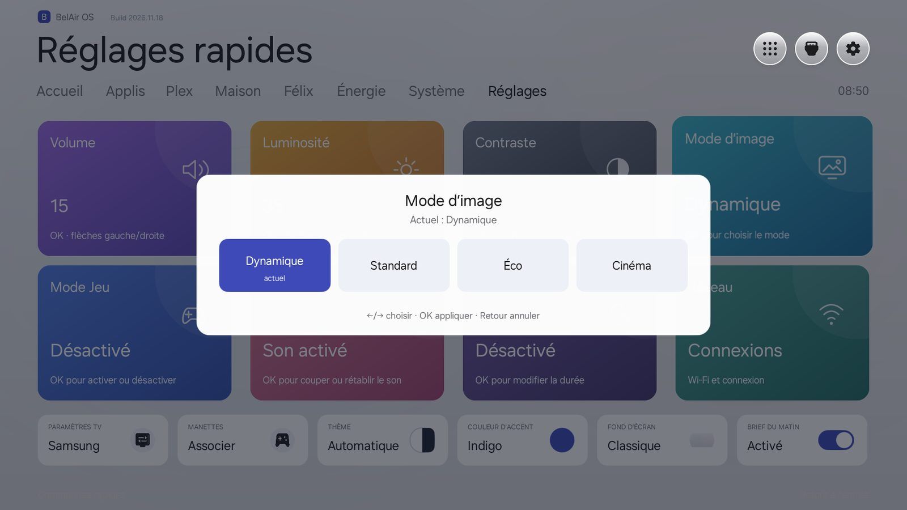

- **Thème** automatique (clair du lever au coucher du soleil à Paris), clair ou sombre ; 6 couleurs d'accent ; fonds d'écran Classique, Météo, Affiche Plex ou Aurore.
- **Économiseur d'écran** pour l'OLED : horloge qui se déplace, météo, températures intérieures, métro.

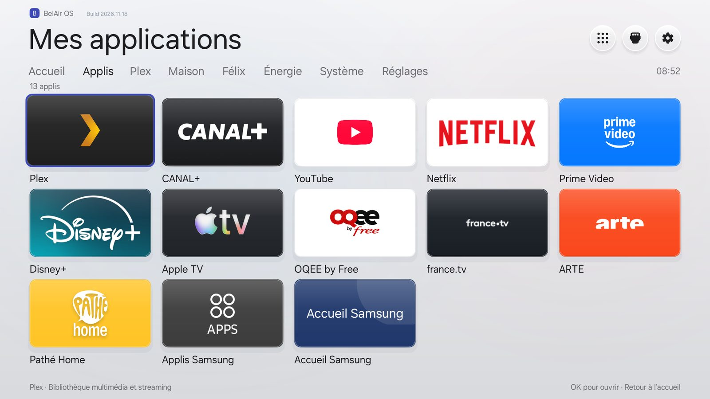

## Architecture

```
┌───────────────────────────┐   app-control    ┌──────────────────────────────┐
│ Home (BixbyPromotion.dll) │ ───────────────▶ │ QuickLaunch (helper, réseau) │
│ interface NUI, pas d'accès│ ◀─────────────── │ Home Assistant, météo, IDFM, │
│ internet                  │   données JSON   │ franceinfo, Yahoo, Wikipédia │
└───────────────────────────┘                  └──────────────────────────────┘
```

- `launcher/src/Home.cs` — l'interface (pages, navigation télécommande, panneaux).
- `launcher/src/QuickLaunch.cs` — l'assistant réseau : il interroge les services, met les images en cache et répond à l'interface. Il reste actif 10 minutes et ouvre la connexion Home Assistant dès son démarrage ; les commandes ont leur propre file et ne patientent jamais derrière une lecture des états.
- Home Assistant pilote lampes, volets, scènes, Apple TV, Plex, Govee et Félix ; l'automatisation du mode cinéma vit dans Home Assistant.

## Installer et déployer

La préparation de la TV (accès root, sauvegardes, nettoyage, installation du launcher, restauration) suit la documentation de Quiet Tizen : [docs/quiet-tizen.md](docs/quiet-tizen.md), puis `docs/01-inventory.md` à `docs/09-recovery.md`.

Compilation :

```bash
python3 tools/build.py launcher --dotnet <dotnet6> --framework <assemblies Tizen extraites de la TV>
```

Le déploiement remplace `BixbyPromotion.dll` et `QuickLaunch.dll` sur la TV (copie, puis redémarrage vérifié du processus). La configuration Home Assistant (URL, jeton) se place sur la TV dans `res/ha-config.json` de QuickLaunch et **n'est jamais versionnée**.

## Données personnelles

Ce dépôt ne contient ni jeton, ni adresse, ni identifiant d'appareil :

- les fichiers propres à la maison (configuration Home Assistant, catalogues Govee avec adresses, captures brutes, sauvegardes) restent dans des chemins ignorés (`.local/`, `*.local.json`) ;
- les logos d'éditeurs extraits de la TV ne sont pas inclus ;
- les captures d'écran ci-dessus ont la carte, les prénoms et les adresses réseau floutés ;
- la position du domicile (centre du plan Vélos) est lue au démarrage dans Home Assistant (`zone.home`) et n'apparaît nulle part dans le code.

## Crédits

- [Quiet Tizen / Free My TV](docs/quiet-tizen.md) pour le launcher de base, les outils et la méthode — voir [NOTICE.md](NOTICE.md) et [docs/provenance.md](docs/provenance.md).
- Données : Home Assistant, Open-Meteo et MET Norway, Île-de-France Mobilités, Vélib' Métropole et Lime (flux GBFS publics), fonds de carte © les contributeurs d'OpenStreetMap, franceinfo, Yahoo Finance, Wikipédia, bibliothèque de scènes Govee.
- Licence : voir [LICENSE](LICENSE).
